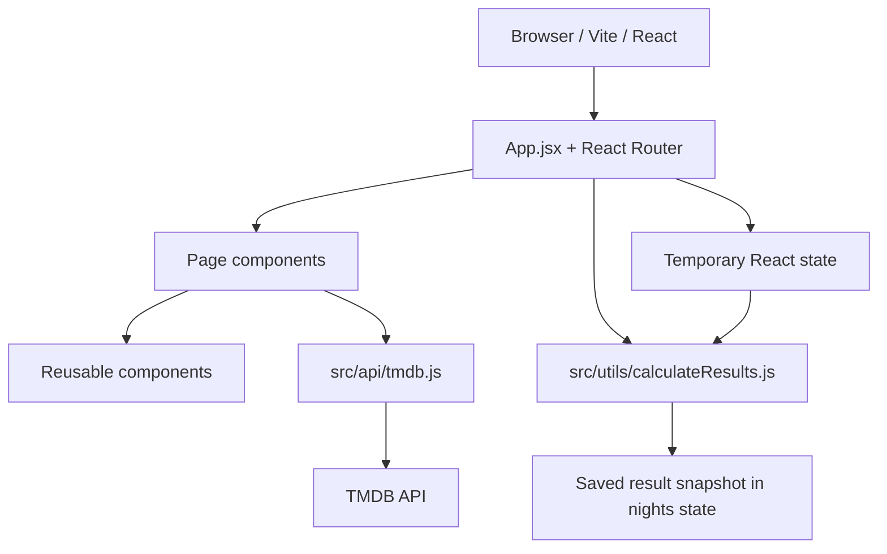

# Movie Night

**A collaborative movie picker that helps groups decide what to watch - fairly.**

Movie Night is a React-based movie discovery and group decision-making application. Search real films through **TMDB**, create a private movie-night group, invite friends with a join code, suggest eligible films, rank a top three, use an optional veto, and reveal a winner with an explanation of the result. A personal watchlist, watched status, completed-night history, and country-specific viewing-provider information round out the experience.

> **Current status: frontend prototype, not yet a deployed full-stack application.** The React interfaces and local business logic were built during the frontend phase. Group records, ballots, preview identities, results, and watchlists currently live only in React memory. The Express + MongoDB backend, real authentication, persistent records, and cross-device synchronization are still to be implemented. Do not use real passwords in the preview forms.

## Contents

- [The idea](#the-idea)
- [Features](#features)
- [How Movie Night works](#how-movie-night-works)
- [Tech stack](#tech-stack)
- [Quick start](#quick-start)
- [Available commands](#available-commands)
- [Pages and routes](#pages-and-routes)
- [Frontend architecture](#frontend-architecture)
- [Business rules and voting](#business-rules-and-voting)
- [TMDB integration](#tmdb-integration)
- [Testing and quality checks](#testing-and-quality-checks)
- [Demo walkthrough](#demo-walkthrough)
- [Current limitations](#current-limitations)
- [Backend roadmap](#backend-roadmap)
- [GitHub submission notes](#github-submission-notes)
- [Troubleshooting](#troubleshooting)
- [Attribution and contributors](#attribution-and-contributors)

## The idea

Choosing a film with friends can become a negotiation: proposals disappear in chat, available time is limited, and the loudest person often decides. **Movie Night** gives everyone a structured voice.

A host creates a group with a maximum movie runtime and shares a short invitation code. Members discover movies via TMDB and contribute suggestions. Each member ranks three different movies (3, 2, and 1 point) and may veto one other movie. After everybody has voted, the host closes the night and the application calculates a winner, applying the runtime and veto rules and using TMDB ratings to resolve point ties. The results explain why each other movie did not win.

**Intended users:** friends, housemates, families, clubs, and other groups organizing a shared screening.

## Features

### Movie discovery

- Search for films by title using the real TMDB API.
- Browse popular films on the Discover page.
- Open a details page with synopsis, release date, genres, rating, runtime, poster, and backdrop.
- View streaming/rental/purchase availability by selected country, where TMDB has data.
- Smooth backdrop reveal, animated loading feedback, error messages, and responsive movie cards.
- Context-aware return navigation from a movie back to Discover, a Night Room, Watchlist, or Results when opened from those pages.

### Collaborative movie nights (frontend preview)

- Signup, login, and logout **interfaces** with form validation and temporary preview identity.
- Create a night with a title and maximum runtime.
- Generate a six-character join code; join an active night using that code.
- List active nights, memberships, and completed nights.
- Search TMDB inside a Night Room and suggest movies after checking their actual runtime.
- Prevent duplicate suggestions and let contributors remove their own suggestions.
- Cast or edit a ballot with three unique ranked selections and up to one veto outside that top three.
- Show per-night voting progress.
- Allow the host to finalize only after all current members have voted.
- Display the winner, eligible runners-up, exclusions, and human-readable reasons.
- Browse completed-night history and revisit results.

### Personal features (frontend preview)

- Add films to a personal watchlist from movie details.
- Mark films watched or not watched, remove them, and filter by status.
- Keep watchlist entries separate between preview identities **within the same running app**.

### UX and quality

- React Router navigation and 404 fallback.
- Responsive dark cinema-inspired interface and keyboard-focus styles.
- Reusable search and loading components.
- Frontend tests for the winner-calculation logic (and a prepared NightCard component test, if copied into the current project).

### Deliberately not included yet

- Downloadable/shareable result PNG cards (postponed).
- Official TMDB logo in the footer (must be added before public deployment).
- Backend authentication and database persistence.
- True live updates between separate devices/browsers.
- Production deployment and backend automated tests.

## How Movie Night works

1. **Discover:** Search or browse a film, and inspect its details and viewing availability.
2. **Enter the preview:** Use the Signup or Login form with dummy data. This is **not** real account registration or password validation.
3. **Create or join:** The host selects a title and runtime cap; other members enter the join code.
4. **Suggest:** Members search TMDB inside the Night Room. Before adding a film, the app fetches full details and checks runtime, duplicates, and membership.
5. **Vote:** Each member ranks three distinct suggested films. A veto is optional and must target a different suggestion.
6. **Finalize:** After all current members submit a ballot, the host closes voting. The app freezes the calculated result in the completed-night object.
7. **Review:** Members see the winner, runner-up ranking, veto/runtime exclusions, and the explanations. They can also revisit the result from History.
8. **Watchlist:** Independently save films and track whether they have been watched.

## Tech stack

| Area | Current technology | Why |
| --- | --- | --- |
| UI | React, JSX, plain CSS | Small reusable components and state-driven rendering |
| Tooling | Vite | Fast local development and production bundling |
| Navigation | React Router | Named pages, dynamic movie/night URLs, guarded UI routes |
| API consumption | Browser `fetch`, `async` / `await` | Simple TMDB HTTP requests |
| Movie data | TMDB API v3 | Search, popular, details, runtime, posters, providers |
| State | React `useState`, props, `useEffect` | Deliberately straightforward frontend course patterns |
| Frontend tests | Vitest + React Testing Library + jsdom | Component and business-logic checks |
| Lint | oxlint | Static code checks |
| Planned API | Node.js + Express | Server-side authentication, authorization, REST routes |
| Planned storage | MongoDB + Mongoose | Persistent users, nights, suggestions, ballots, and watchlists |

## Quick start

**Requirements:** Node.js and npm installed; a valid **TMDB API Read Access Token**. Use a current Node.js release compatible with the locally installed Vite and Vitest versions (`node -v`).

1. Open a terminal at the root of the React project (the folder containing `package.json`).
2. Install dependencies:

   ```bash
   npm install
   ```

3. In the **frontend project root**, create a `.env` file:

   ```env
   VITE_TMDB_TOKEN=your_tmdb_api_read_access_token
   ```

   `VITE_TMDB_API_KEY` is **not needed** by the implementation using the Bearer token. Never commit `.env` to Git.

4. Start the frontend:

   ```bash
   npm run dev
   ```

5. Open the local URL printed by Vite (commonly `http://localhost:5173/`).

**Environment variable caution:** A variable beginning with `VITE_` is included in code delivered to the browser. The TMDB credential is therefore **not secret** in the current frontend-only architecture. Use a development token and, before publishing, move all TMDB calls and the token into the Express backend as `TMDB_TOKEN`.

### Suggested local testing sequence

- Open Discover and search for a film.
- Visit a film details page; check runtime and Where to Watch.
- Log in with a **dummy email and dummy password** (the preview is not authenticating anything).
- Create a night and copy its invitation code.
- Suggest at least three eligible films (four if testing veto).
- Log out and log in with a second **dummy identity**, without refreshing; join by code.
- Submit ballots for all members, then return as host and finalize.
- Open Results, History, and Watchlist.

**Important:** Refreshing the page resets the preview login, nights, suggestions, votes, results, and watchlists.

## Available commands

| Command | Purpose |
| --- | --- |
| `npm run dev` | Start Vite's development server |
| `npm test` | Run the Vitest test suite (requires a `"test": "vitest run"` script in `package.json`) |
| `npm run build` | Create an optimized frontend bundle in `dist/` |
| `npm run preview` | Preview the built bundle locally |
| `npm run lint` | Run oxlint on the project |

The dev server can stay running in one terminal while the other commands run in a second terminal. Passing a production build does **not** prove that backend-dependent features are implemented.

## Pages and routes

| Route | Page | Access in this prototype |
| --- | --- | --- |
| `/` | DiscoverPage | Public |
| `/movie/:id` | MovieDetailsPage | Public |
| `/login` | LoginPage | Guest UI |
| `/signup` | SignupPage | Guest UI |
| `/nights` | NightsPage | Preview identity required |
| `/nights/new` | CreateNightPage | Preview identity required |
| `/nights/join` | JoinNightPage | Preview identity required |
| `/nights/:id` | NightRoomPage | Preview identity and night membership |
| `/nights/:id/vote` | VotePage | Preview identity and night membership |
| `/nights/:id/results` | ResultsPage | Preview identity and night membership |
| `/watchlist` | WatchlistPage | Preview identity required |
| `/history` | HistoryPage | Preview identity required |
| Any unmatched path | 404 fallback | Public |

The guards in React improve navigation only. **They cannot replace Express authentication and ownership checks.**

## Frontend architecture



### Source layout

```text
movie-app-frontend/
├── .env                     # local only; never commit
├── .gitignore
├── .oxlintrc.json
├── index.html
├── package.json
├── package-lock.json
├── vite.config.js
├── public/                  # static assets (official TMDB logo still pending)
└── src/
    ├── main.jsx            # React root mount
    ├── App.jsx             # routes, preview state, shared actions
    ├── index.css           # global styles, layout, responsiveness and animations
    ├── App.css             # additional application styles (check if actively imported)
    ├── popcorn.png         # project branding asset
    ├── api/
    │   └── tmdb.js         # TMDB search, popular, details, providers
    ├── components/
    │   ├── Navbar.jsx
    │   ├── SearchBar.jsx
    │   ├── MovieCard.jsx
    │   ├── MovieList.jsx
    │   ├── NightCard.jsx
    │   ├── LoadingIndicator.jsx
    │   └── WhereToWatch.jsx
    ├── pages/
    │   ├── DiscoverPage.jsx
    │   ├── MovieDetailsPage.jsx
    │   ├── LoginPage.jsx
    │   ├── SignupPage.jsx
    │   ├── NightsPage.jsx
    │   ├── CreateNightPage.jsx
    │   ├── JoinNightPage.jsx
    │   ├── NightRoomPage.jsx
    │   ├── VotePage.jsx
    │   ├── ResultsPage.jsx
    │   ├── WatchlistPage.jsx
    │   └── HistoryPage.jsx
    └── utils/
        ├── calculateResults.js
        └── calculateResults.test.js
```

This tree reflects the files visible in the latest VS Code screenshot and the features built during our guided frontend steps. It is not an independently verified export of the final working directory. Check whether `App.css` is imported before removing or changing it. The currently visible test file is `src/utils/calculateResults.test.js`.

### Data ownership and components

- **`App.jsx`** owns the prototype's common state: `currentUser`, `nights`, `suggestions`, `votes`, and `watchlist`.
- Pages receive the relevant state and callbacks through **props**. This is basic **lifting state up**, not Redux or Context.
- Pages own transient local UI state, such as a search query, loading flag, form fields, or error message.
- **`src/api/tmdb.js`** centralizes HTTP requests; components should not duplicate TMDB headers or URLs.
- **`calculateNightResults()`** is a pure data-calculation function; React renders its returned result.
- The result is saved as a snapshot on a completed night, so later visits do not recalculate a finalized outcome.

### Simplified data objects

```js
// Night
{
  id, title, maxRuntimeMin, joinCode,
  ownerEmail, memberEmails: [],
  status: 'active' | 'completed',
  createdAt, finalizedAt?, result?
}

// Suggestion
{
  id, nightId, tmdbId, title,
  posterPath, runtime, voteAverage, addedByEmail
}

// Ballot - one per user per night
{
  nightId, userEmail,
  rankedIds: [firstSuggestionId, secondSuggestionId, thirdSuggestionId],
  vetoId: suggestionIdOrNull
}

// Watchlist entry
{
  userEmail, tmdbId, title, posterPath,
  releaseDate, runtime, voteAverage,
  watched, addedAt, watchedAt
}
```

These are **frontend preview data shapes**, not finalized MongoDB schemas. The backend will use stable MongoDB IDs and real user references, not email strings as the primary ownership identifiers.

## Business rules and voting

### Suggestion eligibility

- The night must exist and still be active.
- The user must be a member.
- Full TMDB movie details are fetched on suggestion, because search results do not consistently contain runtime.
- Runtime must be known, positive, and at most the night limit.
- The same TMDB movie cannot be suggested twice in one night.
- A member can remove only suggestions they personally added.

### Ballot rules

- At least three suggestions are needed.
- Exactly three **different** suggestion IDs are ranked.
- Rank points are **3 / 2 / 1**.
- One veto is **optional** and cannot target a ranked movie.
- Submitting again replaces that member's existing ballot.
- Removing a suggested film invalidates ballots referring to it, so affected members must vote again.

### Closing and scoring

The host can finalize only when all **current** members have cast a ballot. For each suggestion, the calculation totals points and vetoes, excludes movies with an invalid/over-limit runtime or any veto, sorts eligible movies by points, breaks ties by TMDB rating, and uses the lower TMDB ID as a final deterministic tie-break when needed.

A finalized result contains the **winner**, eligible **runners-up**, **excluded** movies and explanations. If no eligible film remains, finalization fails and members must revise suggestions or ballots. The result is saved inside the completed night object, moving that night into History.

**Note:** The original proposal explicitly requires points, vetoes, runtime checks, and a TMDB rating tie-break. Using a lower TMDB ID when both score and rating tie, and requiring every member to vote before finalization, are additional **frontend implementation decisions**.

## TMDB integration

`src/api/tmdb.js` centralizes four functions:

| Function | TMDB path | Used by |
| --- | --- | --- |
| `getPopularMovies()` | `GET /movie/popular` | Discover default view |
| `searchMovies(query)` | `GET /search/movie?query=...` | Discover and Night Room |
| `getMovieDetails(id)` | `GET /movie/:id` | Movie Details and suggestion runtime validation |
| `getWatchProviders(id)` | `GET /movie/:id/watch/providers` | Where to Watch |

All current calls use `Authorization: Bearer <VITE_TMDB_TOKEN>`. Search terms use `encodeURIComponent`. TMDB image paths are combined with the image base URL; full backdrops use a larger image variant. Streaming/rental options vary by country and may be absent. Where to Watch credits JustWatch and links to the TMDB viewing page, not a made-up direct streaming link.

### Before public release: TMDB attribution

The official **TMDB logo and required API acknowledgement have not yet been integrated**. Add the approved asset and attribution before deploying publicly; the present footer credit alone is not the final attribution implementation. Keep the JustWatch attribution on provider displays. See the official [TMDB logos and attribution page](https://www.themoviedb.org/about/logos-attribution).

## Testing and quality checks

The frontend testing setup created during the project uses **Vitest** and **React Testing Library**. In the latest VS Code folder screenshot, the visible automated test file is:

- `src/utils/calculateResults.test.js` - tests the winner-calculation logic.

A `NightCard.test.jsx` component test was prepared earlier during development, but it does **not** appear in the latest folder screenshot; do not claim that it is currently committed unless you add it to `src/components/`.

To run:

```bash
npm test
npm run build
npm run lint
```

**If `npm test` reports “Missing script: test”**, add `"test": "vitest run"` to the existing `scripts` object in `package.json` and ensure Vitest is installed. These tests are **frontend tests only**: the rubric also requires a backend test, which will be added later.

### Manual regression checklist

- [ ] Popular movies and search load normally.
- [ ] Details and back-navigation return to the correct origin.
- [ ] Backdrops and reusable loading indicators display smoothly.
- [ ] Signup/login preview and logout work without real credentials.
- [ ] Night creation and join-code membership work within one running session.
- [ ] Nonmembers cannot navigate into a group's preview pages.
- [ ] Runtime and duplicate-suggestion checks work.
- [ ] Ballot uniqueness, veto restrictions, and vote updates work.
- [ ] Only the host can finalize, and only after all members vote.
- [ ] Winner, runner-up, excluded-film reasons, and History are correct.
- [ ] Watchlist filters and mark-as-watched work for separate preview identities.
- [ ] Where to Watch handles country selection and missing availability.
- [ ] Desktop/mobile layouts and keyboard navigation are usable.

## Demo walkthrough

A clear 5-8 minute demonstration can follow this sequence:

1. **Problem (30s):** Groups argue over movie choices, runtime restrictions, and fairness.
2. **Discovery (45s):** Search TMDB, open details, and show runtime/provider information.
3. **Group setup (60s):** Preview login, create a night, show runtime cap and join code.
4. **Suggestions (60s):** Add an eligible movie; demonstrate rejecting a long or duplicate film.
5. **Voting (60s):** Show top-three ranks, optional veto, and progress.
6. **Results (75s):** Finalize as host; explain 3/2/1 points, veto exclusion, and TMDB tie-breaking.
7. **Personal features (30s):** Watchlist and completed-night history.
8. **Technical explanation (45s):** React state/props, `fetch`, routing, pure scoring function, tests, and next steps.

All timings are suggested presentation structure, not course deadlines. Because state resets on reload, **prepare your demonstration in one browser session** until persistent storage is implemented.

## Current limitations

1. **No real authentication:** The preview accepts dummy form input; passwords are not validated, hashed, or stored.
2. **No database:** Refreshing clears preview users, nights, member lists, votes, results, and watchlists.
3. **No shared realtime state:** Other browsers and devices do not synchronize; voting progress reflects the current React instance.
4. **Frontend route checks aren't security:** Backend endpoints must independently authenticate and authorize each action.
5. **Preview IDs and join codes:** Local IDs and random join-code logic are intended for demonstration, not secure server-side identity or uniqueness.
6. **TMDB token exposed in frontend:** Migrate the token to Express before deploying.
7. **Shareable PNG:** Deferred intentionally.
8. **TMDB logo/official attribution:** Still pending before deployment.
9. **Deployment and backend tests:** Not complete.

## Backend roadmap

The planned stack is **Node.js + Express + MongoDB + Mongoose** (MongoDB is allowed by the capstone specification). Existing React pages and components should largely remain intact; only the data source and server-enforced business logic change.

Planned server resources: users, nights, memberships, suggestions, ballots, watchlists, finalized results; and TMDB proxy endpoints. Implement signup/login with bcrypt and JWT, input validation, membership and ownership checks, CRUD routes, consistent error/status responses, and tests. Move scoring and finalization checks onto the server; persist results in MongoDB. Then replace local React updates with `fetch` calls and use polling (for example every 15 seconds while a room is open) for cross-device voting progress.

## GitHub submission notes

Place this file in the root of your frontend working directory as **`README.md`**, alongside `package.json`. GitHub displays the README automatically when viewing the frontend branch. The existing `.gitignore` should continue excluding `.env`, `node_modules/` and `dist/`.

If Git is already connected and you are currently on the correct frontend branch, save the file and run:

```bash
git status
git add README.md
git commit -m "Add frontend project README"
git push
```

For the initial push of the entire frontend instead, stage all non-ignored project files using `git add .`. Verify the active branch with `git branch --show-current` before pushing. **Do not commit `.env` or expose your TMDB token in README screenshots or text.**

## Troubleshooting

| Problem | What to check |
| --- | --- |
| `Failed to resolve import "./pages/SignupPage"` | Correct `src/pages/SignupPage.jsx` filename and default export |
| Movie search fails | Valid `VITE_TMDB_TOKEN`, `.env` in the project root, restart Vite after `.env` changes, browser network errors |
| `npm test`: missing script | Add `"test": "vitest run"` to `package.json` and install test dependencies |
| `API_KEY is declared but never used` | Remove the unused `VITE_TMDB_API_KEY` declaration; the project uses a Bearer token |
| Night data disappears | Expected: React `useState` data resets on refresh |
| Native dropdown highlight still blue | OS/browser styling limits the appearance of native `<select>` options |
| Where to Watch is empty | Country-specific provider information may not exist in TMDB |
| Sharing/download not found | Downloadable result cards were intentionally skipped |
| Dev server port differs | Use the local URL actually printed by Vite |

## Attribution and contributors

**Project:** Movie Night - full-stack capstone proposal, currently in the frontend stage.  
**Proposal contributors:** Miguel Aoun and Sara Abi Ghosn (as named in the original capstone proposal).  
**Movie metadata and imagery:** [The Movie Database (TMDB)](https://www.themoviedb.org/).  
**Watch provider information:** [JustWatch](https://www.justwatch.com/) via TMDB.

This README documents the frontend developed in the guided project steps, cross-checked where possible against the latest folder screenshot. It does not claim to be a complete code audit. Before final submission, compare the file tree and function names with your latest working directory, and add the live repository and deployed URLs once available.
